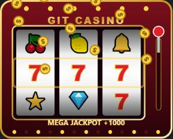

# 🎰 Git Casino

Мод для Claude Code: каждый `git commit`, который делает Claude, крутит игровой автомат прямо в панели приложения.



## Как играть

- **Коммит крутит бесплатно.** Барабаны встают по очереди, со звуком: треск, стук остановки, фанфары или грустный тромбон.
- **Чистый коммит ×2.** Если после прошлого коммита ни одна команда не упала, выигрыш удваивается. Серия чистых коммитов считается вместе с рекордом.
- **Ставка на CI.** После `git push` мод следит за GitHub Actions по этому коммиту. Зелёный с первой попытки даёт +300, красный забирает 50.
- **Ручной спин.** Кнопки «Крутить» (10 фишек) и «Три спина» (30) в панели.

| Комбинация | Выигрыш |
| --- | --- |
| 7️⃣ 7️⃣ 7️⃣ | +1000 |
| 💎 💎 💎 | +500 |
| три одинаковых | +200 |
| пара | +30 |
| мимо | −10 |

Фишки, статистика и настройка звука сохраняются между сессиями.

## Установка

В терминале Claude Code (не в чате десктопного приложения) выполни:

```
/plugin install git-casino --marketplace Talap-creator/git-casino
```

На вопрос `Add marketplace?` ответь `y`, затем выбери scope `user`. Мод сразу заработает в этой сессии, а со scope `user` и во всех следующих, включая вкладку Code в десктопном приложении.

### Вручную, из клона

```bash
git clone https://github.com/Talap-creator/git-casino
```

```bash
claude --plugin-dir ./git-casino
```

Для десктопного приложения добавь абсолютный путь к папке в `CLAUDE_CODE_PLUGIN_DIRS` в блоке `env` файла `~/.claude/settings.json`.

## Команды

| Что | Как |
| --- | --- |
| Открыть панель | `/casino` |
| Звук вкл/выкл | `/casino-mute` или кнопка в панели (`M`) |
| Крутить | кнопка «Крутить» (`S`) |
| Три спина | кнопка «Три спина» (`3`) |

## Требования

- Claude Code 2.1.295 или новее (API модов в раннем доступе и может меняться).
- Звук: Windows (через PowerShell `SoundPlayer`) и macOS. На Linux без звука.
- Ставка на CI: установленный и залогиненный [`gh`](https://cli.github.com/).
- Мод видит репозиторий коммита, если команда начинается с `cd <репо> &&`, использует `git -C <репо>` или сессия запущена в самом репозитории.

## Звуки

Все звуки синтезированы скриптом, без сторонних сэмплов. Поменять ноты и пересобрать:

```bash
python sounds/generate.py
```

## English

A Claude Code mod: every `git commit` Claude makes spins a slot machine in a pane, with sound. A clean commit (nothing failed since the last one) pays double, and a green CI run on the first try after `git push` pays a bonus. Install with `/plugin install git-casino --marketplace Talap-creator/git-casino` from a Claude Code terminal. The UI is in Russian.

## Лицензия

MIT
